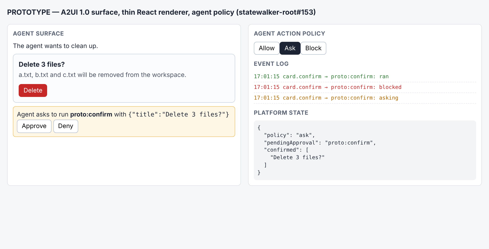

# PROTOTYPE: @statewalker/proto-a2ui-surface

**Throwaway prototype for statewalker-root#153. Never merged, never published.** Lives only on
branch `claude/great-faraday-igm9os`.

The question: does the client spec layer decided in statewalker-root#115 work end to end
(A2UI 1.0 via `@a2ui/web_core` 0.15.0, `defineComponent` with Zod, our own thin React renderer,
events → `@statewalker/shared-commands`, Allow/Ask/Block for agent surfaces, a 0.9.1 shim, a
json-render import)? Does a thin renderer hold up?

```sh
pnpm --filter @statewalker/proto-a2ui-surface test   # 23 vitest tests
pnpm --filter @statewalker/proto-a2ui-surface dev    # Vite demo: surface, event log, policy toggle
```



## Files

| File | What it is | LOC |
|---|---|---|
| `src/define-component.ts` | `defineComponent`, Zod 4 → JSON Schema → A2UI entry, `buildCatalog` | 118 |
| `src/renderer.tsx` | Thin React renderer over web_core's `NodeResolver` | 97 |
| `src/basic-renderers.tsx` | Text, Column, Row, Card, Button as plain React | 24 |
| `src/actions.ts` | Action router: event → command, Allow/Ask/Block | 96 |
| `src/shim-v09.ts` | v0.9/v0.9.1 → 1.0 message upgrade | 42 |
| `src/json-render-adapter.ts` | json-render catalog → A2UI entries (and back, for the round trip) | 37 |
| `src/catalog.tsx`, `src/agent.ts` | `ConfirmCard`, `ConfirmCommand`, the fake model | 80 |

## Findings

- web_core does the protocol work: processing messages, validating against the catalog, the data
  model, and resolving the tree (`NodeResolver` hands back resolved props, child nodes and bound
  action closures). Because of that, the renderer is about 100 lines. Unknown components are
  **accepted** under default (relaxed) validation and come back as `state: "unknown-type"`. The
  renderer has to refuse them, or the processor has to run with `STRICT_VALIDATION`.
- The pure Zod basic APIs (`TextApi`…) are not exported for v1. The only entry point is
  `basicCatalog` from `./catalogs/basic/v1`, which brings Lit web components into the bundle
  (demo bundle is about 840 kB minified).
- web_core uses zod 3 and the repo uses zod 4, so there are two zods. They only meet through JSON
  Schema (`z.toJSONSchema` → `Catalog.fromJson`), and that works. Its public types leak zod 3
  (TS2883: exported catalogs need an explicit type).
- web_core turns JSON Schema back into zod with a derivation that accepts **any value** for
  `anyOf`, and zod 4 writes `.nullable()` as `anyOf`. `toCatalogEntry` rewrites that pattern as a
  type array. Other unions would still pass unchecked.
- web_core ties a surface to its catalog's spec version, so it refuses v0.9.1 messages aimed at a
  1.0 catalog. The shim is 42 lines: change the version, map the catalog id, drop Text h1–h5 (a lossy
  change) and the theme.
- Component events are not part of A2UI: in A2UI, the agent wires `action.event` names on
  Buttons. Our events go through `surface.dispatchAction`, and the router looks up the component
  type in the surface model, so an agent cannot spoof `confirm` from a Button.
- `defineComponent` props are plain literals: our components cannot take data bindings
  (`DynamicString`).
- render.core holds json-render registries opaquely and has no component definitions, so the
  adapter was tested against a minimal `defineCatalog` catalog.
